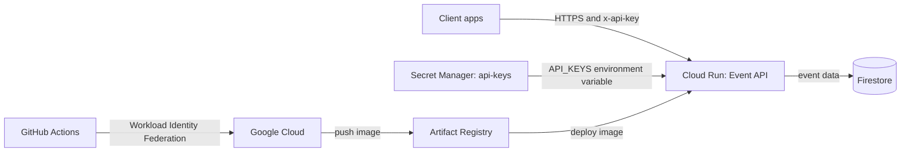

# Event API

A small event-ingestion API for apps that need to send activity in batches
and retrieve daily event counts. Each API key identifies a client, and each
client can see only its own statistics.

The [live SDK demo](https://activity-tracker-514608.web.app/) sends click
events to this API and shows today's counts. Its source is in the
[Events SDK repository](https://github.com/mohammad-abu-assad/events-sdk).

## Architecture



Cloud Run uses a runtime service account for Firestore and the `api-keys`
secret. GitHub Actions uses a separate deployer account through Workload
Identity Federation, without a long-lived Google service-account key file.
The service is configured in `europe-west1` for zero to two instances.
Cloud Monitoring checks `/health` every minute and has an email alert for
uptime failures; see the [runbook](docs/runbook.md#uptime-alert).

## API

The complete contract, request schemas, and error responses are in
[openapi.yaml](openapi.yaml).

| Endpoint | Authentication | Purpose |
| --- | --- | --- |
| `GET /health` | None | Returns `{"status":"ok"}`. |
| `POST /v1/events` | `x-api-key` | Accepts 1–100 events in a batch. |
| `GET /v1/stats?from=YYYY-MM-DD&to=YYYY-MM-DD` | `x-api-key` | Returns daily counts for the authenticated client. |

Stats dates are UTC and inclusive, with a maximum range of 31 days. Requests
are limited to 100 KB and 60 authenticated requests per minute per key **per
instance**. The `sdk-public-demo` client ID is limited to 10 requests per minute
per instance. The in-memory limiter is not shared across Cloud Run instances,
and each request can contain up to 100 events; this is not a global cost cap.
The memory store is for local development and tests; its events disappear
when the process stops. The Firestore store persists events.

### Browser access (CORS)

The API allows browser requests from `https://activity-tracker-514608.web.app`,
`https://activity-tracker-514608.firebaseapp.com`, and HTTP `localhost` origins
(including development ports). CORS preflight requests under `/v1` are handled
before authentication and allow `GET`, `POST`, `Content-Type`, and `X-API-Key`.
Actual protected requests still require a valid API key. Other origins do not
receive permission to read API responses. CORS is a browser policy, not a
substitute for authentication or rate limiting.

The public demo uses its own low-limit key. A key included in browser code is
visible to visitors and must not be treated as private.

## Local setup

Install Node.js 22 and npm, then run:

```sh
npm ci
cp .env.example .env
```

Edit `.env` to add your own client ID and key to `API_KEYS`. Keep the file
private: it is gitignored. Then start the development server:

```sh
npm run dev
curl http://localhost:8080/health
```

The development command loads `.env` when present and restarts on source
changes. Tests use the memory store and do not need Google Cloud.

### Environment variables

| Variable | Purpose | Default |
| --- | --- | --- |
| `PORT` | HTTP listening port. | `8080` |
| `STORE` | `memory` for local data or `firestore` for persistent data. | `memory` |
| `API_KEYS` | JSON object mapping client IDs to keys. | No keys; protected requests return 401. |

For local use, set `API_KEYS` in `.env`. In Cloud Run it comes from Secret
Manager. Do not commit real keys or print them in logs.

## Test and build

```sh
npm run check
npm test
npm run build
npm start
```

`npm start` runs the compiled output. The Docker image uses a multi-stage
build, includes production dependencies, and runs as the non-root `node` user.

## Load test

[load/load.js](load/load.js) sends one-event batches with one virtual user,
waiting one second between requests for 30 seconds. Each accepted `load_test`
event remains in the store. Provide the target and a valid key as environment
variables; do not put the key in the command line or repository.

```sh
export BASE_URL='https://event-api-401789805659.europe-west1.run.app'
read -s API_KEY
export API_KEY
k6 run load/load.js
unset API_KEY
```

When `read -s API_KEY` waits, paste the key and press Enter; the terminal
does not display it. These commands work in bash and zsh.

### Measured baseline

On **2026-11-13, 15:24:04–15:24:35 UTC**, k6 ran from a Mac against the live
Cloud Run service with one virtual user. The 30-second scenario plus graceful
completion took about 31 seconds.

| Measure | Result |
| --- | ---: |
| Accepted requests | 26 of 26 |
| Throughput | 0.838 requests/second |
| HTTP response duration, p95 | 256.53 ms |
| Failed HTTP requests | 0% |
| New instances observed in startup logs during the test | 0 |

The test deliberately waits between requests to respect the per-key limit;
this is a functional baseline, not a maximum-throughput benchmark. Cloud
Monitoring samples instance count once per minute, and no sample fell inside
the 31-second test window. The samples immediately before and after showed
two existing instances; this does not establish the exact peak during the
test or prove that no unlogged instance started.

## Rollback drill

On **2026-11-13**, a deliberately broken image returned HTTP 500 from
`/health`. Routing traffic to the previous known-good revision and checking
for HTTP 200 took **7.72 seconds**, measured from starting the traffic-update
command until the first successful health response. This is one observation,
not a guaranteed recovery time. A healthy revision was then deployed and
traffic was restored to the latest revision so future CI deployments can
receive traffic normally.

The intentionally broken `event-api-rollback-drill-1794583516` revision
remains in the revision history; it should not receive traffic.

See [the runbook](docs/runbook.md) for rollback steps and links to the
[manual cloud setup](docs/manual-cloud-setup.md) and
[GitHub federation setup](docs/github-federation-setup.md).
